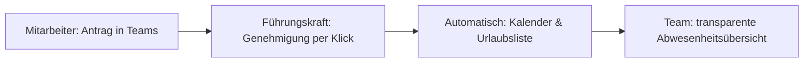

# Urlaubsantragsprozess mit Absentify

**Bereich:** Prozessautomatisierung · Power Automate · SharePoint · Microsoft Teams
**Organisation:** MDBM

## Ausgangslage

Urlaubsanträge liefen vorher manuell per E-Mail, Papierform, Absprache mit Vorgesetzten. Der Prozess war intransparent – niemand hatte auf einen Blick einen Überblick über genehmigte Abwesenheiten, Anträge gingen zwischen Abteilungen verloren, und die Anbindung an Kalender und Urlaubslisten musste per Hand gepflegt werden. Ein früherer Lösungsversuch über eine SharePoint-Liste mit einem Standard-Workflow funktionierte nicht zuverlässig und wurde von den Mitarbeitenden nicht angenommen, weil das Set-up zu technisch war und die Mitarbeiter den Zusammenhang zwischen Ablageort auf Sharepoint und Automatisierung des Vorgangs nicht nachvollziehen konnten.

## Meine Rolle

Ich habe den Prozess von Grund auf analysiert und mit **Absentify** neu aufgebaut – von der Tool-Auswahl über die Konfiguration bis zur Einführung im Team. Als Assistentin der Geschäftsleitung war ich dabei gleichzeitig Prozessverantwortliche, Ansprechpartnerin für alle Mitarbeitenden und Schnittstelle zur IT.

## Lösung

Digitale Urlaubsanträge über Absentify in Microsoft Teams:

1. **Antrag** direkt in Teams gestellt – inkl. automatischer Resturlaubsanzeige
2. **Genehmigung** durch Führungskraft per Knopfdruck in Outlook
3. **Automatische Integration**: Genehmigungen landen automatisch in der Urlaubsübersicht – ohne manuelle Nachpflege
4. **Schnelle Analyse per Ecxel Extrakt**: meine Aufgabe besteht auch darin z.B. Resturlaube and die Lohnabrechnung zu melden, dies ist mit einem Excel Auszug problemlos möglich und flexibel auswertbar 

## Ergebnis

- Vollständig digitaler, transparenter Urlaubsantrag – von der Beantragung bis zur Genehmigung ohne einen einzigen Papierbogen oder Suchlauf
- Die Prozessschritte, die vorher per Hand gepflegt werden mussten, entfallen komplett: Einsparung von ca. 10 Stunden pro Monat
- Höhere Akzeptanz im Team, weil der Prozess grafisch so aufgebaut ist dass ihn alle in Teams finden und leicht bedienen können
- Das Scheitern der alten Lösung hat mir gezeigt: Prozessexzellenz ohne Nutzerakzeptanz ist wertlos – genau daran arbeite ich

## Lessons Learned

- **Change beginnt bei der Nutzererfahrung:** Absentify wurde angenommen, weil es in Teams integriert ist – nicht, weil es technisch besser war
- **Fehlgeschlagene Lösungen sind Lernraum:** Der nicht funktionierende erste Ansatz hat den Weg zur robusten Lösung geebnet
- **Automatisierung in kleinen Schritten:** Ein simpler E-Mail-Workflow schafft Vertrauen für größere Automatisierung

## Screenshots

*Anonymisierte Screenshots folgen.*
