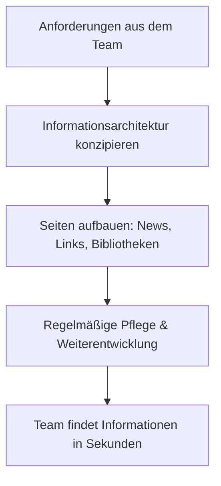

# SharePoint-Seiten- & Infrastrukturaufbau

**Bereich:** SharePoint Online · Information Architecture · Microsoft 365
**Organisation:** Kardex

## Ausgangslage

[[Wie war es vorher? z. B.: Informationen verstreut in E-Mails und Netzwerkordnern, veraltete Intranet-Struktur, niemand fand aktuelle Dokumente oder Ansprechpartner.]]

## Meine Rolle

Als SharePoint-Seiten-Erstellerin habe ich nicht nur Seiten gepflegt, sondern die Informationsarchitektur aktiv mitgestaltet: Ich habe [[Konzeption, Aufbau und Pflege]] von Team- und Kommunikationsseiten übernommen, Strukturen für [[Abteilung/Team/Organisation]] aufgebaut und die Kolleginnen und Kollegen dabei begleitet, die neuen Seiten im Alltag zu nutzen.

## Lösung

Ein strukturierter SharePoint-Aufbau, der aus einer Dateiablage einen echten Informationsraum macht:

1. **Seitenarchitektur:** Übersichtliche Startseiten mit News-, Quick-Links- und Inhaltsbereichen – statt endloser Ordnerlisten
2. **Zentrale Ablage:** Dokumentenbibliotheken mit klarer Ordnerlogik und [[ggf. Metadaten/Versionierung]]
3. **Aktualität als Verantwortung:** Regelmäßige Pflege und Weiterentwicklung der Seiten – ein Intranet lebt von aktuellen Inhalten
4. **Nähe zu den Nutzenden:** Ich habe die Seiten dort gestaltet, wo die Menschen arbeiten – mit Teams-Integration und [[z. B. Zielseiten für Abteilungen]]

## Ergebnis

- [[Konkretisieren: z. B. „Wichtige Dokumente und Ansprechpartner sind auf einer zentralen Seite findbar statt in E-Mail-Verläufen zu verschwinden"]]
- [[Zahlen, wenn möglich: Anzahl Seiten/Bibliotheken, Nutzer, Zeitersparnis]]
- Ein Intranet-Bereich, den Menschen tatsächlich aufrufen – weil er aktuell und relevant ist

## Lessons Learned

- **Information Architecture ist Consultingleistung:** Die technische Seite in SharePoint ist schnell gelernt – die Kunst ist, Informationen so zu strukturieren, dass sie im Alltag gefunden werden
- **Ein Intranet ist nie fertig:** Seiten brauchen regelmäßige Pflege, sonst verlieren sie Vertrauen
- **Ordnung entsteht durch Nutzung:** Die beste Struktur nützt nichts, wenn sie am Arbeitsalltag der Menschen vorbeigeht

## Screenshots

*Anonymisierte Screenshots folgen.*
