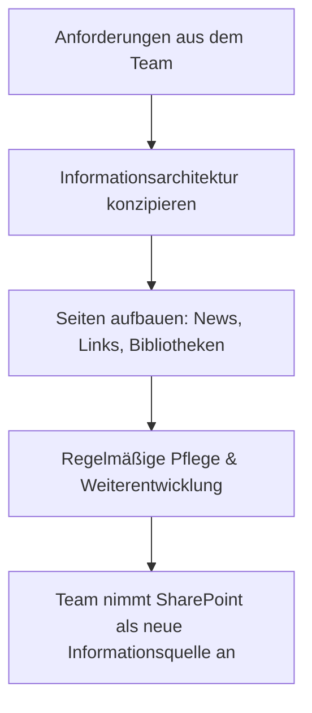

# SharePoint-Seiten- & Infrastrukturaufbau

**Bereich:** SharePoint Online · Information Architecture · Microsoft 365
**Organisation:** Kardex

## Ausgangslage

Im Rahmen einer konzernweiten Strategie zur Reduzierung des E-Mail-Aufkommens sollte ein zentrales SharePoint-Intranet als primäre Informations- und Kommunikationsquelle etabliert werden.

## Meine Rolle

Als Assistentin des Entwicklungsleiters habe ich den SharePoint-Bereich für die Technology-Abteilung eigenverantwortlich konzipiert, grafisch gestaltet und inhaltlich umgesetzt.

## Lösung

Ein strukturierter SharePoint-Aufbau, der aus einer Dateiablage einen echten Informationsraum macht:

1. **Anwesenheits- & Transparenzkalender:** Implementierung eines Kalenders zur Vor-Ort-Präsenz der Abteilungsleitung zur vereinfachten Abstimmung für Mitarbeitende.
2. **Stakeholder-Einbindung:** Integration eines öffentlichen Sprint-Review-Kalenders zur transparenten Information von Schnittstellen außerhalb des Projektteams.
3. **Content- & Wissensmanagement:** Regelmäßige Aufbereitung und Bereitstellung von Berichten aus Team-Meetings.
4. **User Adoption & Engagement:** Gezielte Förderung von Interaktivität (Kommentare, Likes) zur Steigerung der Plattform-Akzeptanz innerhalb der Abteilung.

## Ergebnis

Transparentere Schnittstellenkommunikation, Reduzierung von E-Mail-Verteilern und erfolgreiche Akzeptanzsteigerung für Modern-Workplace-Tools in der Technology-Abteilung.

## Lessons Learned

- **Information Architecture ist Consultingleistung:** Die technische Seite in SharePoint ist schnell gelernt – die Kunst ist, Informationen so zu strukturieren, dass sie im Alltag gefunden werden
- **Ein Intranet ist nie fertig:** Seiten brauchen regelmäßige Pflege, sonst verlieren sie Vertrauen
- **Ordnung entsteht durch Nutzung:** Die beste Struktur nützt nichts, wenn sie am Arbeitsalltag der Menschen vorbeigeht

