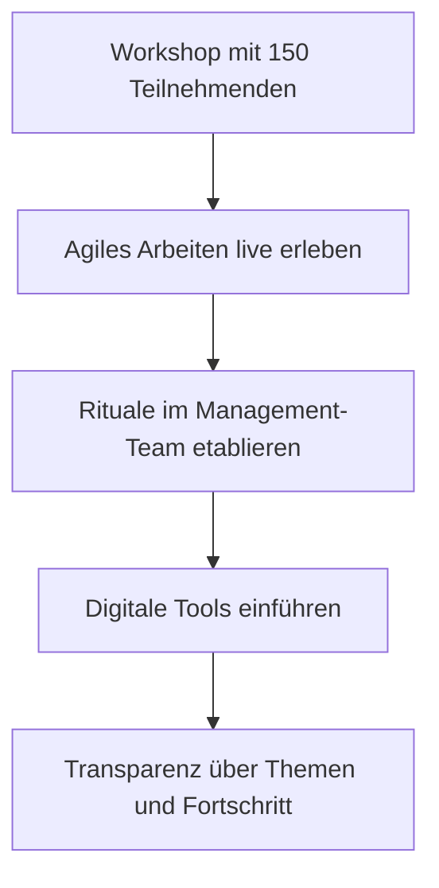

# Agile Begleitung eines Management-Teams

**Bereich:** Change Management · Agile Arbeitsweisen · Transformation
**Organisation:** Kardex

## Ausgangslage

Es gab die strategische Entscheidung abteilungsweit vom klassischen zum agilen Projektmanagement zu wechseln, um Leadzeiten zu verkürzen. Nach einem abteilungsübergreifenden Kick Off wurden Pilot Teams ausgewählt. Eins davon war das Management-Team. Bisher gab es lange Abstimmungsketten, lange Statusmeetings und wenig Transparenz über laufende Themen. Die Herausforderung: Die Menschen im Team waren erfahren und erfolgreich in ihrer gewohnten Art zu arbeiten – Veränderung durfte hier nicht als Belehrung ankommen. Das Team bekam einen erfahrenen agile Coach zur Seite gestellt.

## Meine Rolle

Ich habe die agile Transformation an der Schnittstelle zwischen Organisation, Methoden-Adaption und Praxisbegleitung unterstützt:

1. **Event- & Logistik-Management:** Komplette organisatorische und technische Vor- und Nachbereitung des Großgruppen-Kick-offs mit 150 Teilnehmenden.
2. **Agiles Mindset & Continuous Learning:** Aktives Mitglied in der agile Community of Practice (CoP). Durch den stetigen Austausch mit Scrum Mastern und Agile Coaches habe ich mir die Scrum-Methodik sowie die Haltung (Selbstorganisation, Wertschätzung, Agilität) aneignet.
3. **Operatives Coaching-Enablement:** Enge Zusammenarbeit mit dem Agile Coach bei der Konzeption und praktischen Umsetzung neuer Formate für das Management-Team.
4. **Transparenz & Tool-Struktur:** Aufbau und Pflege von Miro-Boards sowie Confluence-Strukturen, um Abteilungs-Pipelines und Abstimmungsketten nachhaltig zu vereinfachen.

## Lösung

Statt Methodenschulung „von oben" haben wir Transformation erfahrbar gemacht:

1. **Erleben vor Einführen:** Der Workshop hat agiles Zusammenarbeit erlebbar gemacht, bevor Rituale im Alltag etabliert wurden
2. **Dranbleiben im Alltag:** Die eigentliche Transformation passierte nach dem Workshop – in begleiteten Meetings, beim Aufbau von Retrospektiven und Boards
3. **Digitale Werkzeuge als Enabler:** Transparenz-Tools machten Fortschritt sichtbar und schufen Verbindlichkeit

## Ergebnis

- Ein Management-Team, das seine Zusammenarbeit aktiv hinterfragt und weiterentwickelt
- 150 Teilnehmende haben in einem Workshop erlebt, dass Veränderung nicht bedrohlich, sondern bereichernd sein kann
- [[Wenn möglich ergänzen: z. B. „Meeting-und Abstimmungsaufwand spürbar reduziert", „Team hat eigenständig Retrospektiven weitergeführt"]]
- Für mich persönlich die Bestätigung: Transformation ist zuallererst menschliche Arbeit – und genau da ist meine Stärke

## Lessons Learned

- **Transformation braucht Vertrauenspersonen:** Methoden kommen an, wenn sie von jemandem eingeführt werden, der den Alltag der Menschen kennt
- **Große Formate wirken durch Erfahrung:** 150 Menschen gemeinsam etwas erleben zu lassen, schafft mehr Akzeptanz als jede Präsentation
- **Der Alltag ist die eigentliche Transformation:** Der Workshop war der Startpunkt – entscheidend war das Dranbleiben in den Wochen danach

## Screenshots

*Anonymierte Fotos/Impressionen vom Workshop folgen.*
