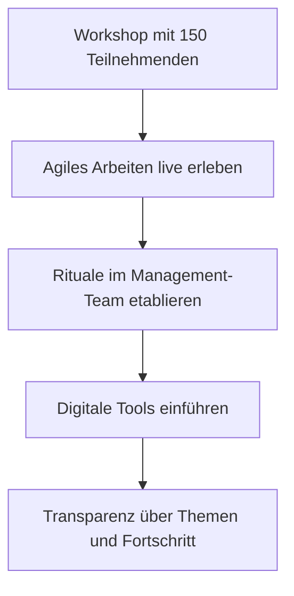

# Agile Begleitung eines Management-Teams

**Bereich:** Change Management · Agile Arbeitsweisen · Transformation
**Organisation:** [[MDBM]]

## Ausgangslage

Ein Management-Team sollte von klassischen, hierarchischen Arbeitsweisen zu agileren Formen der Zusammenarbeit finden –[[z. B.: lange Abstimmungsketten, wenig Transparenz über laufende Themen, Entscheidungen zogen sich über Wochen hin]]. Die Herausforderung: Die Menschen im Team waren erfahren und erfolgreich in ihrer gewohnten Art zu arbeiten – Veränderung durfte hier nicht als Belehrung ankommen.

## Meine Rolle

Als rechte Hand des Agile Coachs habe ich die Transformation praktisch mitgetragen – und dabei genau die Schnittstelle besetzt, die oft fehlt: zwischen Methodik und Alltag. Konkret:

- **Organisation einer Großveranstaltung:** Ich habe einen Workshop für **150 Teilnehmende** geplant und durchgeführt – von der Konzeption über die operative Vorbereitung bis zur Nachbereitung
- **Begleitung im Alltag:** Ich habe das Management-Team bei der Etablierung agiler Rituale unterstützt, damit Methoden nicht in der Moderation stecken bleiben, sondern im Arbeitsalltag ankommen
- **Tool-Enablement:** Mit [[Miro, Confluence und/oder Jira]] habe ich die passenden Werkzeuge eingeführt, damit Transparenz und Zusammenarbeit auch digital gelebt werden

## Lösung

Statt Methodenschulung „von oben" haben wir Transformation erfahrbar gemacht:

1. **Erleben vor Einführen:** Der Workshop hat agiles Zusammenarbeit erlebbar gemacht, bevor Rituale im Alltag etabliert wurden
2. **Dranbleiben im Alltag:** Die eigentliche Transformation passierte nach dem Workshop – in begleiteten Meetings, beim Aufbau von Retrospektiven und Boards
3. **Digitale Werkzeuge als Enabler:** Transparenz-Tools machten Fortschritt sichtbar und schufen Verbindlichkeit

## Ergebnis

- Ein Management-Team, das seine Zusammenarbeit aktiv hinterfragt und weiterentwickelt
- 150 Teilnehmende haben in einem Workshop erlebt, dass Veränderung nicht bedrohlich, sondern bereichernd sein kann
- [[Wenn möglich ergänzen: z. B. „Meeting-und Abstimmungsaufwand spürbar reduziert", „Team hat eigenständig Retrospektiven weitergeführt"]]
- Für mich persönlich die Bestätigung: Transformation ist zuallererst menschliche Arbeit – und genau da ist meine Stärke

## Lessons Learned

- **Transformation braucht Vertrauenspersonen:** Methoden kommen an, wenn sie von jemandem eingeführt werden, der den Alltag der Menschen kennt
- **Große Formate wirken durch Erfahrung:** 150 Menschen gemeinsam etwas erleben zu lassen, schafft mehr Akzeptanz als jede Präsentation
- **Der Alltag ist die eigentliche Transformation:** Der Workshop war der Startpunkt – entscheidend war das Dranbleiben in den Wochen danach

## Screenshots

*Anonymierte Fotos/Impressionen vom Workshop folgen.*
