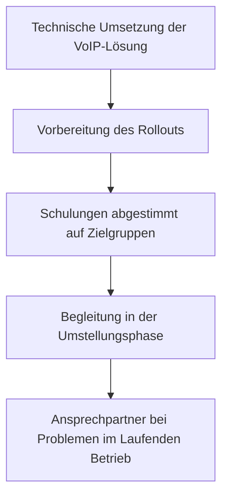

# VoIP-Umstellung – technisch umgesetzt und eingeführt

**Bereich:** Technische Umsetzung · Einführung · Schulung · Change Management · Digitale Transformation
**Organisation:** mdbm

## Ausgangslage

Ich habe angeregt die klassische Telefonanlage auf VoIP umzustellen um unabhängig vom Arbeitsort eine gleichbleibende Kundenerfahrung und Erreichbarkeit herzustellen. Ein Vorhaben, das auf dem Papier nur Technik ist – im Alltag aber jeden einzelnen Arbeitsplatz verändert: neue Geräte, neue Bedienung, neue Gewohnheiten bei einer Technik, die täglich genutzt wird. Hinzu kam eine große Skepsis der Geschäftsleitung die mit dieser Technologie bisher nicht vertraut war.

## Meine Rolle

Ich habe dieses Projekt **eigenständig und end-to-end verantwortet** – von der technischen Umsetzung bis zur Einführung im Team:

1. **Technische Umsetzung:** Ich habe die VoIP-Lösung großteilig alleine eingerichtet (einen Provider herausgesucht, die Nummern Portieren lassen, die Endgeräte installieren lassen und selbst konfiguriert
2. **Einführung:** Ich habe den Rollout für alle betroffenen Mitarbeitenden vorbereitet und begleitet
3. **Schulung:** Ich habe die Nutzerinnen und Nutzer an die neue Technologie herangeführt
4. **Begleitung im Alltag:** Ich bin die erste Anlaufstelle bei Fragen und Problemen und verwalte als Administrator alle Nutzer, Ziele und Rufnummern

## Lösung

Mein Ansatz dabei: Technikeinführung ist Beziehungsarbeit. Wer Fragen stellen darf, ohne sich dumm zu fühlen, akzeptiert schneller. Und wer die Technik selbst aufgebaut hat, kann sie so erklären, dass jeder sie versteht.

## Ergebnis

- Die Umstellung habe ich in **Personalunion aus einer Hand** verantwortet: Technik, Einführung, Schulung, Support
- [[Konkretisieren, z. B. „[[X]] Endgeräte/Mitarbeitende umgestellt", „Betrieb lief ohne größere Ausfälle weiter"]]
- Bestätigung meines Leitbilds: Transformation gelingt, wenn die Begleitung der Menschen Teil des Projektplans ist – nicht sein Nachtrag

## Lessons Learned

- **End-to-end-Verantwortung schärft den Blick:** Wer Technik, Einführung und Support verantwortet, plant von Anfang an mitdenkend für die Menschen – nicht nachträglich
- **Telefonie ist Gefühlssache:** Eine „kleine" Technikumstellung berührt den Alltag jedes Einzelnen – Begleitung ist kein Nice-to-have
- **Zielgruppengerecht schulen:** Ein Training für alle passt für niemanden
